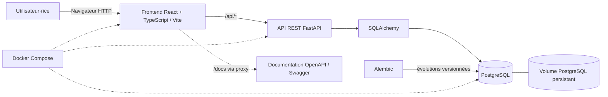

# Architecture GearTrack

Le frontend est servi par Nginx dans l'image de production et transmet `/api` au backend. En développement, Vite relaie les mêmes chemins vers `localhost:8000`. Les migrations sont exécutées avant le démarrage de FastAPI. Les données ne sont jamais préremplies.
