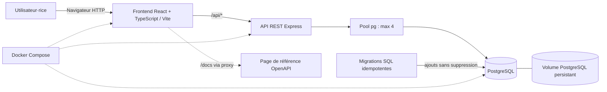

# Architecture GearTrack

En production, Express sert le frontend compilé et l'API sur le port 3000. Le proxy du cours retire le préfixe public avant de transmettre les requêtes. En développement, Nginx sert le frontend et relaie `/api` vers Express dans Compose ; Vite relaie les mêmes chemins vers le port hôte GearTrack. Les migrations SQL additives/idempotentes sont exécutées avant l'écoute HTTP. Les données ne sont jamais préremplies.
